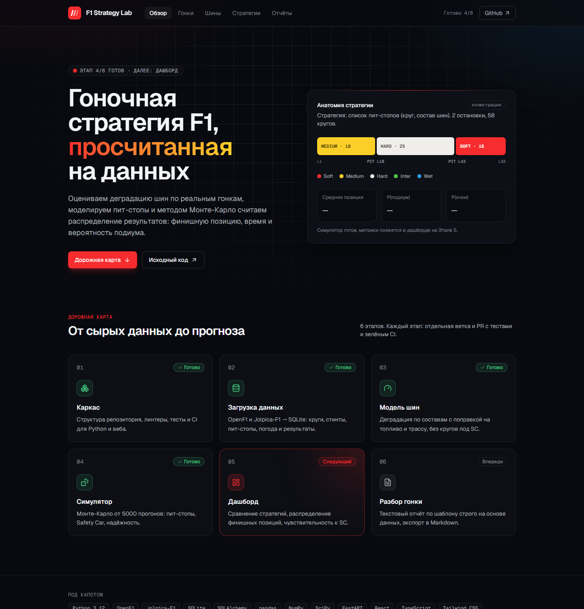
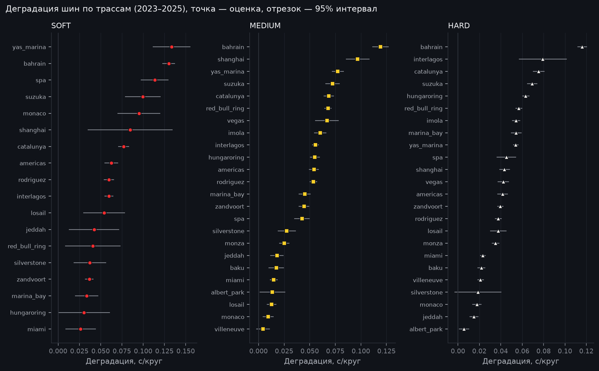

# F1 Strategy Lab

[](https://github.com/tachiroz/f1-strategy-lab/actions/workflows/ci.yml)

Симулятор гоночной стратегии Formula 1. По данным реальных гонок оценивает деградацию шин,
моделирует стратегии пит-стопов и методом Монте-Карло считает распределение результатов:
финишная позиция, время, вероятность подиума.

Итог проекта: веб-дашборд, воспроизводимый пайплайн данных и автоматический текстовый разбор гонки.



## Статус

| Этап | Что делаем | Статус |
|---|---|---|
| 1. Каркас | Структура, линтеры, тесты, CI, оболочка дашборда | ✅ готово |
| 2. Загрузка данных | OpenF1 + Jolpica-F1 → SQLite, кэш, идемпотентная загрузка | ✅ готово |
| 3. Модель шин | Деградация по составам с поправкой на топливо и трассу | ✅ готово |
| 4. Симулятор | Монте-Карло, пит-стопы, Safety Car, надёжность | ⏳ следующий |
| 5. Дашборд | Сравнение стратегий, распределения, чувствительность к SC | — |
| 6. Разбор гонки | Текстовый отчёт по шаблону, экспорт в Markdown | — |

Подробный план и правила работы описаны в [CLAUDE.md](CLAUDE.md), история изменений в [CHANGELOG.md](CHANGELOG.md).

## Стек

| Часть | Технологии |
|---|---|
| Данные | [OpenF1](https://openf1.org) (круги, шины, погода, race control), [Jolpica-F1](https://github.com/jolpica/jolpica-f1) (расписание, результаты, пит-стопы) |
| Хранилище | SQLite через SQLAlchemy Core (позже, возможно, PostgreSQL) |
| Расчёты | Python 3.12, pandas, NumPy, SciPy |
| API | FastAPI |
| Дашборд | React + TypeScript (Vite), Tailwind CSS |
| Качество | ruff, pytest, Oxlint, Prettier, Vitest, pre-commit |
| CI | GitHub Actions (ubuntu + windows) |

Runtime-зависимости Python добавляются на том этапе, где они реально понадобятся.

## Структура

```
f1-strategy-lab/
  src/f1lab/          # Python-пакет
    config.py         # пути и константы (никаких магических чисел в коде)
    ingest/           # клиенты Jolpica и OpenF1, трансформации, загрузчик, CLI
    db/               # схема, движок SQLite, проверки качества данных
    models/           # модель шин: фильтр кругов, SC/VSC, регрессия, оценка, графики
    sim/              # Монте-Карло, стратегии, Safety Car
    report/           # авто-разбор гонки
    api/              # FastAPI: JSON для дашборда
  web/                # дашборд: React + TypeScript + Vite + Tailwind
  sql/                # аналитические запросы и проверки качества данных
  tests/              # pytest; tests/fixtures — записанные реальные ответы API
  notebooks/          # исследования
  data/               # HTTP-кэш API и база SQLite (в .gitignore)
  docs/               # документация, отчёт модели (docs/models), скриншоты
```

## Быстрый старт

Нужны Python 3.12, Node.js 24 LTS или новее (с npm) и Git.

### Python

Windows (PowerShell):

```powershell
python -m venv .venv
.venv\Scripts\Activate.ps1
python -m pip install -e ".[dev]"
pre-commit install
```

Linux / macOS:

```bash
python3.12 -m venv .venv
source .venv/bin/activate
python -m pip install -e ".[dev]"
pre-commit install
```

### Данные

```bash
python -m f1lab.ingest                          # сезоны 2023–2025
python -m f1lab.ingest --season 2024 --round 1  # одна гонка
python -m f1lab.ingest --season 2025 --force    # перезагрузить уже загруженное
python -m f1lab.db.quality                      # проверки качества данных
```

Первая загрузка трёх сезонов занимает около 10 минут: так велят лимиты OpenF1 (не больше 30 запросов в минуту).
Ответы API кэшируются в `data/cache`, поэтому повторные запуски работают без сети и за секунды.
База появится в `data/f1lab.sqlite`. Открыть её можно в DBeaver, DB Browser for SQLite или `sqlite3`.

### Модель шин

```bash
python -m f1lab.models     # обучение 2023–2024, тест 2025, отчёт в docs/models
```

### Дашборд

```bash
cd web
npm ci
npm run dev        # http://localhost:5173
```

## Данные

### Источники

| Источник | Что берём | Ограничения |
|---|---|---|
| [Jolpica-F1](https://github.com/jolpica/jolpica-f1) | расписание, результаты, пит-стопы, пилоты | 4 запроса/с, 500 в час |
| [OpenF1](https://openf1.org) | круги, стинты и составы шин, погода, race control | данные с 2023 года; 3 запроса/с, 30 в минуту |

FastF1 не используется: архив тайминга F1, из которого он берёт данные, отвечает 403 из сети автора
(блокировка по IP).

### Таблицы

| Таблица | Строка | Ключ |
|---|---|---|
| `races` | гонка, ссылка на сессию OpenF1 | `race_id` = сезон × 100 + этап (202401) |
| `drivers` | пилот | `driver_id` (id Jolpica, например `max_verstappen`) |
| `results` | итог пилота в гонке | (race_id, driver_id) |
| `pit_stops` | пит-стоп: круг, время в пит-лейне | (race_id, driver_id, stop) |
| `laps` | круг: время, сектора, скорости, out-lap | (race_id, driver_id, lap) |
| `stints` | стинт: состав, диапазон кругов, возраст шины | (race_id, driver_id, stint) |
| `weather` | замер погоды раз в минуту | (race_id, time_utc) |
| `race_control` | сообщения дирекции: флаги, SC/VSC, штрафы | (race_id, seq) |
| `ingest_runs` | когда и сколько строк загружено | race_id |

Длительности хранятся в секундах, моменты времени в ISO 8601 (UTC). Схема описана в
[`src/f1lab/db/schema.py`](src/f1lab/db/schema.py).

Пример запроса: средний темп по составам шин в гонке, [`sql/tyre_pace_by_compound.sql`](sql/tyre_pace_by_compound.sql).

После загрузки 2023–2025 в базе (12,6 МБ):

| races | drivers | results | pit_stops | laps | stints | weather | race_control |
|---:|---:|---:|---:|---:|---:|---:|---:|
| 70 | 28 | 1 398 | 2 558 | 77 373 | 3 977 | 11 069 | 6 286 |

Из 10 проверок качества данных 9 проходят. Десятая (`incomplete_lap_coverage`) честно показывает дыру
в самом OpenF1: для Майами-2025 там 559 из ~1100 кругов. Пример запроса показывает, зачем нужна модель
шин: в Бахрейне-2024 харды в среднем быстрее софтов (96,8 с против 97,3 с), потому что простое среднее
смешивает состав шин с массой топлива и возрастом резины.

## Модель шин

Для каждой трассы строится линейная регрессия по «чистым» кругам (без SC/VSC, пит-стопов, дождя и
выбросов): уровень пилота в гонке + топливо × круг + сдвиг состава + деградация состава × возраст шины.
Наклоны деградации сжимаются к общему наклону состава (эмпирический Байес), и износ не экстраполируется
дальше возраста шины, встречавшегося на трассе. Метод, допущения и разбор ошибок описаны в
[docs/models/tyre_model.md](docs/models/tyre_model.md), все числа в
[docs/models/results.md](docs/models/results.md).



На отложенном 2025 году (обучение 2023–2024) ошибка времени круга (MAE) такая:

| Вариант | MAE, с |
|---|---|
| средний круг пилота | 0,785 |
| топливо + состав | 0,560 |
| деградация по трассе | 0,545 |
| **деградация со сжатием и ограничением возраста** | **0,514** |

Итоговая модель на 35% точнее базовой и лучше варианта без деградации на 17 трассах из 24. Сильнее
всего она помогает на SOFT (0,674 → 0,548 с) и на трассах со стабильным износом (Бахрейн: 0,67 → 0,39 с).
Хуже варианта без деградации она там, где износ изменился между сезонами (Сузука), и в мокрых гонках.

### Особенности источников

Данные хранятся как есть. Учитывать эти особенности будут модели на следующих этапах.

- Пилоты в OpenF1 указаны номером машины, а в Jolpica идентификатором. Они сопоставляются через номер
  в протоколе конкретной гонки, потому что «постоянный» номер у Jolpica текущий (у Ферстаппена 3, а в 2024 он ездил под №1).
- Jolpica датирует Лас-Вегас-2024 на день раньше OpenF1, поэтому гонки и сессии сопоставляются по дате
  с допуском ±1 день. Отменённая Имола-2023 в OpenF1 помечена `is_cancelled` и пропускается.
- Во время красного флага машины стоят в пит-лейне, и Jolpica записывает это как пит-стоп на 20+ минут
  (Сан-Паулу-2024).
- У дисквалифицированного пилота в Jolpica `laps = 0`, хотя круги в OpenF1 есть. У сошедших в OpenF1
  бывает лишний неполный круг без времени. Поэтому проверка «круг за пределами дистанции» сравнивает
  с числом кругов победителя.
- У не стартовавшего пилота стинт без диапазона кругов.
- У некоторых пит-стопов в Jolpica пустая длительность (Цунода: Британия-2024, Австрия-2025). Такой пит-стоп
  сохраняется с `duration_s = NULL`.
- После клетчатого флага OpenF1 иногда открывает ещё один круг без времени (38 таких кругов за 2023–2025).
- Бывают стинты из нуля кругов (`lap_end = lap_start − 1`): шины сменили до первого пройденного круга
  (старт с пит-лейна в Монако-2025, красный флаг в Австралии-2023).
- В 305 из ~2600 переходов между стинтами круг пит-стопа (in-lap) входит в оба стинта. Проверка
  подтверждает, что это всегда круг пит-стопа; при разметке шин он относится к старому стинту.
- Состав шин в двух стинтах `UNKNOWN`.
- Для Майами-2025 в OpenF1 только 559 из ~1100 кругов (у большинства пилотов нет кругов 2–24); живой API
  отдаёт то же самое.
- В OpenF1 нет флага Safety Car на каждом круге: периоды SC/VSC восстанавливаются из `race_control`.

## Проверки

Эти же проверки запускает CI на каждый push в `main` и на каждый PR.

| Python (из корня) | Web (из `web/`) |
|---|---|
| `ruff check .` | `npm run lint` |
| `ruff format --check .` | `npm run format:check` |
| `pytest` | `npm test` |
| `pre-commit run --all-files` | `npm run build` (с проверкой типов) |

Автоформатирование: `ruff format .` и `npm run format`.

Тесты Python работают без сети: они читают записанные реальные ответы API из `tests/fixtures`
(Бахрейн-2024 и мокрый Сан-Паулу-2024 с красным флагом). Дополнительно:

- `pytest -m network`: live-проверка, что поля API, от которых зависит загрузчик, на месте;
- `python tests/fixtures/fetch_fixtures.py`: заново записать фикстуры.

## Конфигурация

| Переменная | Назначение | По умолчанию |
|---|---|---|
| `F1LAB_DATA_DIR` | Каталог для HTTP-кэша API и базы SQLite | `data/` в корне репозитория |

URL, лимиты запросов и сезоны по умолчанию заданы константами в [`src/f1lab/config.py`](src/f1lab/config.py).

Данные, кэш, базы и `.env` в репозиторий не коммитятся.

## Как ведётся работа

- Один этап = одна ветка `feat/stage-N-name` → PR в `main`.
- Небольшие коммиты в стиле [Conventional Commits](https://www.conventionalcommits.org/ru/v1.0.0/): `feat:`, `fix:`, `test:`, `docs:`, `chore:`, `ci:`.
- В `main` попадает только зелёное: линтеры и тесты проходят локально и в CI.

## Лицензия

[MIT](LICENSE). Неофициальный проект, не связан с Formula 1, FIA и командами.
Источники данных: [OpenF1](https://openf1.org) и [Jolpica-F1](https://github.com/jolpica/jolpica-f1).
