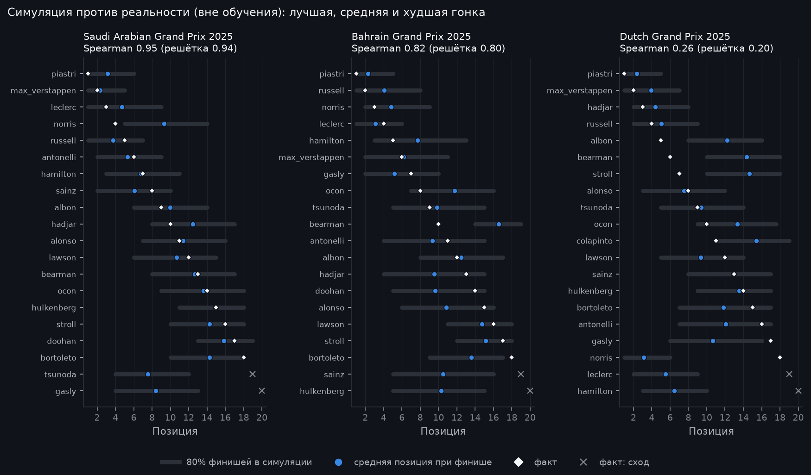
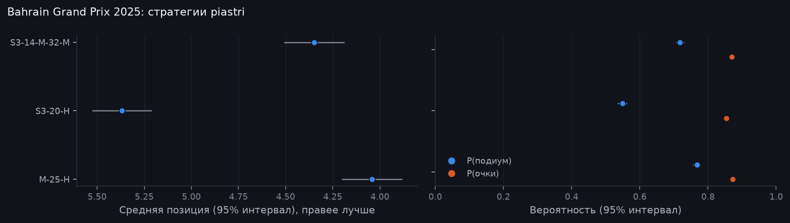
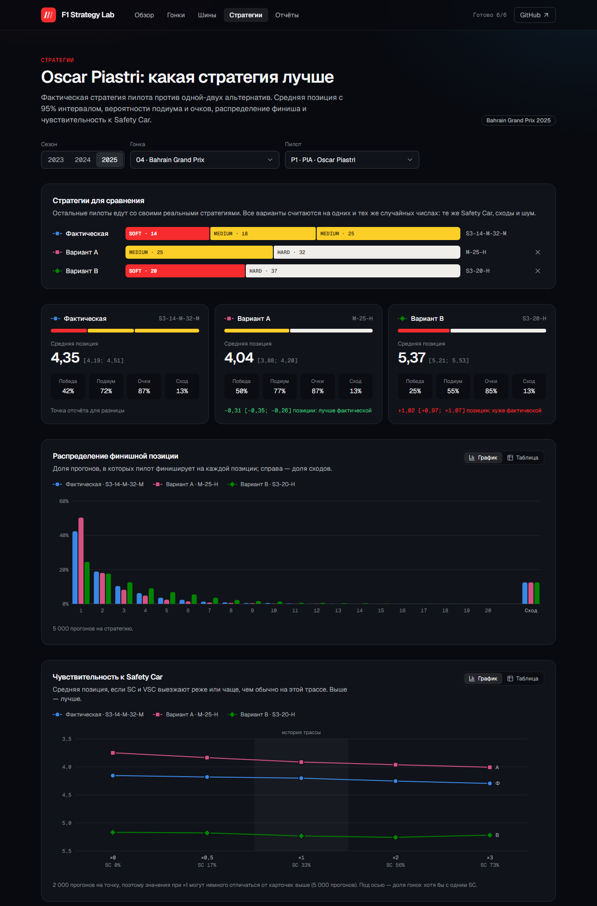
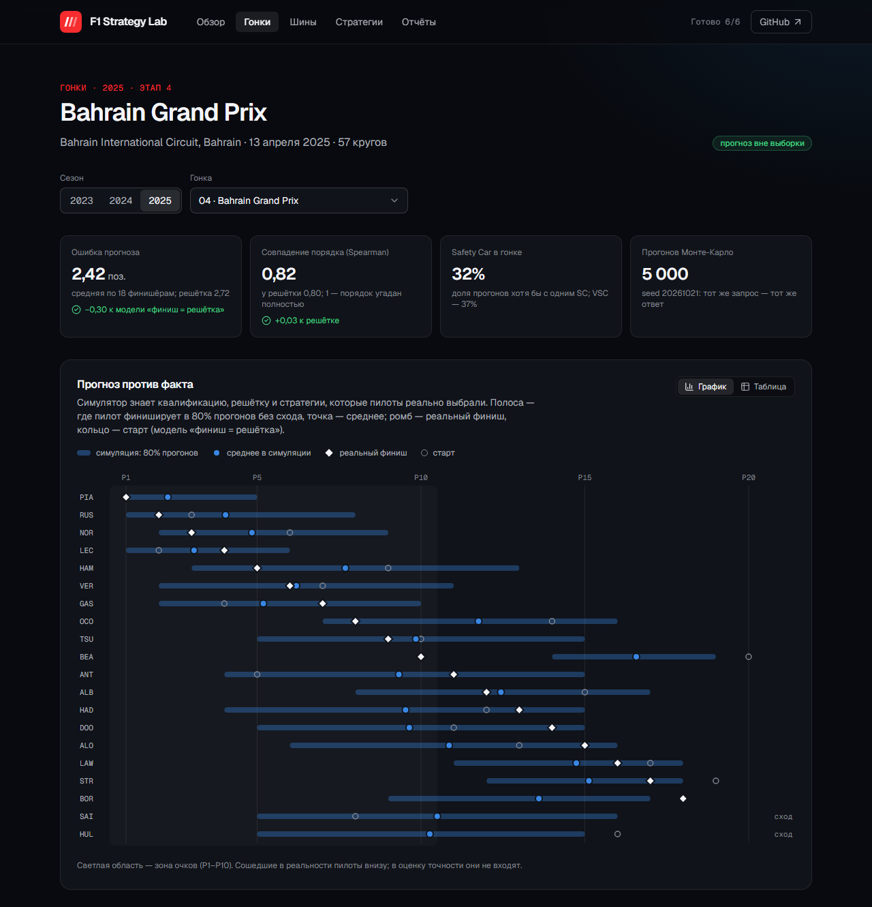
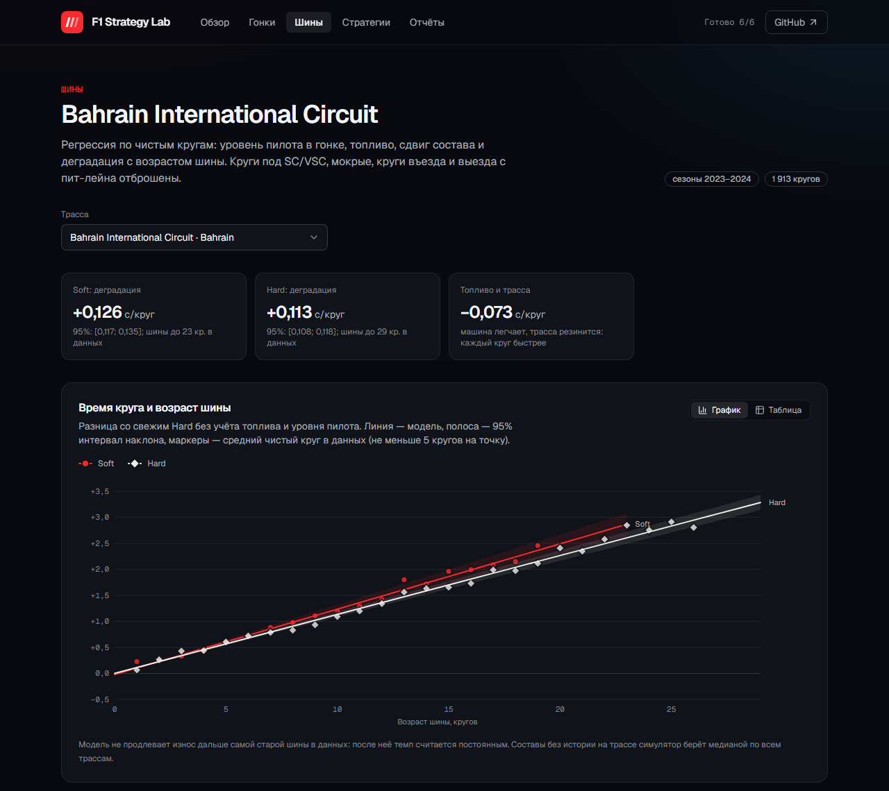
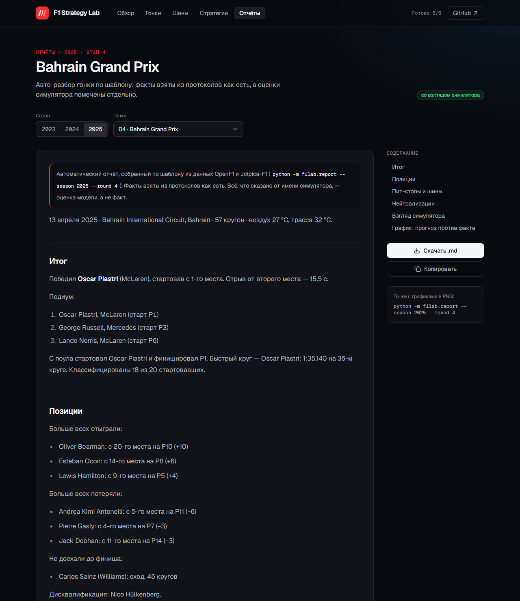

# F1 Strategy Lab

[](https://github.com/tachiroz/f1-strategy-lab/actions/workflows/ci.yml)

Симулятор гоночной стратегии Formula 1. По данным реальных гонок оценивает деградацию шин,
моделирует стратегии пит-стопов и методом Монте-Карло считает распределение результатов:
финишная позиция, время, вероятность подиума.

Итог проекта: веб-дашборд, воспроизводимый пайплайн данных и автоматический текстовый разбор гонки.


## Статус

| Этап | Что делаем | Статус |
|---|---|---|
| 1. Каркас | Структура, линтеры, тесты, CI, оболочка дашборда | ✅ готово |
| 2. Загрузка данных | OpenF1 + Jolpica-F1 → SQLite, кэш, идемпотентная загрузка | ✅ готово |
| 3. Модель шин | Деградация по составам с поправкой на топливо и трассу | ✅ готово |
| 4. Симулятор | Монте-Карло, пит-стопы, Safety Car, надёжность | ✅ готово |
| 5. Дашборд | Сравнение стратегий, распределения, чувствительность к SC | ✅ готово |
| 6. Разбор гонки | Текстовый отчёт по шаблону, экспорт в Markdown | ✅ готово |
| 7. WEC / Ле-Ман | Расширение на гонки на выносливость (опционально) | ⏸ по решению |

Подробный план и правила работы описаны в [CLAUDE.md](CLAUDE.md), история изменений в [CHANGELOG.md](CHANGELOG.md).

## Стек

| Часть | Технологии |
|---|---|
| Данные | [OpenF1](https://openf1.org) (круги, шины, погода, race control), [Jolpica-F1](https://github.com/jolpica/jolpica-f1) (расписание, результаты, пит-стопы) |
| Хранилище | SQLite через SQLAlchemy Core (позже, возможно, PostgreSQL) |
| Расчёты | Python 3.12, pandas, NumPy, SciPy |
| API | FastAPI, uvicorn |
| Дашборд | React + TypeScript (Vite), Tailwind CSS, React Router, TanStack Query; графики — свои SVG-компоненты на d3-scale и d3-shape |
| Отчёт | шаблон Jinja2 → Markdown, графики matplotlib; в дашборде — react-markdown + remark-gfm |
| Качество | ruff, pytest, Oxlint, Prettier, Vitest, pre-commit |
| CI | GitHub Actions (ubuntu + windows) |

Runtime-зависимости Python добавляются на том этапе, где они реально понадобятся.

## Структура

```
f1-strategy-lab/
  src/f1lab/          # Python-пакет
    config.py         # пути и константы (никаких магических чисел в коде)
    ingest/           # клиенты Jolpica и OpenF1, трансформации, загрузчик, CLI
    db/               # схема, движок SQLite, проверки качества данных
    models/           # модель шин: фильтр кругов, SC/VSC, проезды по пит-лейну, регрессия, графики
    sim/              # симулятор: стратегии, калибровка, движок Монте-Карло, бэктест
    report/           # авто-разбор гонки: факты, шаблон Jinja2, графики, CLI
    api/              # FastAPI: JSON для дашборда (схемы ответов, сервис с кэшем)
  web/                # дашборд: React + TypeScript + Vite + Tailwind
    src/api/          # клиент API, типы ответов, хуки TanStack Query
    src/charts/       # SVG-графики: исходы гонки, позиции, деградация, чувствительность к SC
    src/pages/        # разделы: обзор, гонки, шины, стратегии, отчёты
  sql/                # аналитические запросы и проверки качества данных
  tests/              # pytest; tests/fixtures — записанные реальные ответы API
  notebooks/          # исследования
  data/               # HTTP-кэш API и база SQLite (в .gitignore)
  docs/               # допущения, отчёты модели (docs/models), симулятора (docs/sim), примеры разборов (docs/reports)
```

## Быстрый старт

Нужны Python 3.12, Node.js 24 LTS или новее (с npm) и Git.

### Python

Windows (PowerShell):

```powershell
python -m venv .venv
.venv\Scripts\Activate.ps1
python -m pip install -e ".[dev]"
pre-commit install
```

Linux / macOS:

```bash
python3.12 -m venv .venv
source .venv/bin/activate
python -m pip install -e ".[dev]"
pre-commit install
```

### Данные

```bash
python -m f1lab.ingest                          # сезоны 2023–2025
python -m f1lab.ingest --season 2024 --round 1  # одна гонка
python -m f1lab.ingest --season 2025 --force    # перезагрузить уже загруженное
python -m f1lab.db.quality                      # проверки качества данных
```

Первая загрузка трёх сезонов занимает около 10 минут: так велят лимиты OpenF1 (не больше 30 запросов в минуту).
Ответы API кэшируются в `data/cache`, поэтому повторные запуски работают без сети и за секунды.
База появится в `data/f1lab.sqlite`. Открыть её можно в DBeaver, DB Browser for SQLite или `sqlite3`.

### Модель шин

```bash
python -m f1lab.models     # обучение 2023–2024, тест 2025, отчёт в docs/models
```

### Симулятор

```bash
python -m f1lab.sim race --season 2025 --round 4            # исходы гонки при реальных стратегиях
python -m f1lab.sim compare --season 2025 --round 4 --driver piastri --strategy M-25-H --strategy S3-20-H
python -m f1lab.sim backtest                                # проверка на 2025, отчёт в docs/sim
python -m f1lab.sim race-craft                              # подбор параметров обгона на 2023–2024
```

Стратегия записывается так: `M-25-H` — старт на новых медиумах, пит-стоп в конце 25-го круга на
харды; `S3-14-M-32-M` — старт на софтах с тремя кругами пробега, пит-стопы на 14-м и 32-м кругах.

### Разбор гонки

```bash
python -m f1lab.report --season 2025 --round 4               # docs/reports/2025-04-bahrain.md + PNG
python -m f1lab.report --season 2025 --round 1 --out reports # в другой каталог
```

Отчёт по сухой гонке собирается секунд за 15: калибровка, 5000 прогонов гонки и проверка стратегий
призёров. Мокрые гонки симулятор не считает, их отчёт содержит только факты.

### API и дашборд

Нужна загруженная база (см. «Данные» выше). В двух терминалах:

```bash
uvicorn f1lab.api.main:app          # API на http://127.0.0.1:8000, документация: /docs
```

```bash
cd web
npm ci
npm run dev                         # дашборд на http://localhost:5173
```

Dev-сервер Vite проксирует `/api` на `http://127.0.0.1:8000`. Если API запущен на другом порту, задайте
адрес переменной `F1LAB_API_URL`, например `F1LAB_API_URL=http://127.0.0.1:8765 npm run dev`.
Первый запрос после старта API занимает около 5 секунд: симулятор калибруется на 2023–2024 и
держит результат в памяти. Без базы дашборд откроется и подскажет, как загрузить данные.

## Данные

### Источники

| Источник | Что берём | Ограничения |
|---|---|---|
| [Jolpica-F1](https://github.com/jolpica/jolpica-f1) | расписание, результаты, пит-стопы, пилоты | 4 запроса/с, 500 в час |
| [OpenF1](https://openf1.org) | круги, стинты и составы шин, погода, race control | данные с 2023 года; 3 запроса/с, 30 в минуту |

FastF1 не используется: архив тайминга F1, из которого он берёт данные, отвечает 403 из сети автора
(блокировка по IP).

### Таблицы

| Таблица | Строка | Ключ |
|---|---|---|
| `races` | гонка, ссылка на сессию OpenF1 | `race_id` = сезон × 100 + этап (202401) |
| `drivers` | пилот | `driver_id` (id Jolpica, например `max_verstappen`) |
| `results` | итог пилота в гонке | (race_id, driver_id) |
| `qualifying` | позиция и время Q1–Q3 | (race_id, driver_id) |
| `pit_stops` | пит-стоп: круг, время в пит-лейне | (race_id, driver_id, stop) |
| `laps` | круг: время, сектора, скорости, out-lap | (race_id, driver_id, lap) |
| `stints` | стинт: состав, диапазон кругов, возраст шины | (race_id, driver_id, stint) |
| `weather` | замер погоды раз в минуту | (race_id, time_utc) |
| `race_control` | сообщения дирекции: флаги, SC/VSC, штрафы | (race_id, seq) |
| `ingest_runs` | когда и сколько строк загружено | race_id |

Длительности хранятся в секундах, моменты времени в ISO 8601 (UTC). Схема описана в
[`src/f1lab/db/schema.py`](src/f1lab/db/schema.py). Старая база обновляется до новой версии схемы
сама (миграции в `db/engine.py`); квалификацию для уже загруженных гонок подтянет
`python -m f1lab.ingest --force`.

Пример запроса: средний темп по составам шин в гонке, [`sql/tyre_pace_by_compound.sql`](sql/tyre_pace_by_compound.sql).

После загрузки 2023–2025 в базе (12,6 МБ):

| races | drivers | results | pit_stops | laps | stints | weather | race_control |
|---:|---:|---:|---:|---:|---:|---:|---:|
| 70 | 28 | 1 398 | 2 558 | 77 373 | 3 977 | 11 069 | 6 286 |

Из 10 проверок качества данных 9 проходят. Десятая (`incomplete_lap_coverage`) честно показывает дыру
в самом OpenF1: для Майами-2025 там 559 из ~1100 кругов. Пример запроса показывает, зачем нужна модель
шин: в Бахрейне-2024 харды в среднем быстрее софтов (96,8 с против 97,3 с), потому что простое среднее
смешивает состав шин с массой топлива и возрастом резины.

### Особенности источников

Данные хранятся как есть. Учитывать эти особенности будут модели на следующих этапах.

- Пилоты в OpenF1 указаны номером машины, а в Jolpica идентификатором. Они сопоставляются через номер
  в протоколе конкретной гонки, потому что «постоянный» номер у Jolpica текущий (у Ферстаппена 3, а в 2024 он ездил под №1).
- Jolpica датирует Лас-Вегас-2024 на день раньше OpenF1, поэтому гонки и сессии сопоставляются по дате
  с допуском ±1 день. Отменённая Имола-2023 в OpenF1 помечена `is_cancelled` и пропускается.
- Во время красного флага машины стоят в пит-лейне, и Jolpica записывает это как пит-стоп на 20+ минут
  (Сан-Паулу-2024).
- У дисквалифицированного пилота в Jolpica `laps = 0`, хотя круги в OpenF1 есть. У сошедших в OpenF1
  бывает лишний неполный круг без времени. Поэтому проверка «круг за пределами дистанции» сравнивает
  с числом кругов победителя.
- У не стартовавшего пилота стинт без диапазона кругов.
- У некоторых пит-стопов в Jolpica пустая длительность (Цунода: Британия-2024, Австрия-2025). Такой пит-стоп
  сохраняется с `duration_s = NULL`.
- После клетчатого флага OpenF1 иногда открывает ещё один круг без времени (38 таких кругов за 2023–2025).
- Бывают стинты из нуля кругов (`lap_end = lap_start − 1`): шины сменили до первого пройденного круга
  (старт с пит-лейна в Монако-2025, красный флаг в Австралии-2023).
- В 305 из ~2600 переходов между стинтами круг пит-стопа (in-lap) входит в оба стинта. Проверка
  подтверждает, что это всегда круг пит-стопа; при разметке шин он относится к старому стинту.
- Состав шин в двух стинтах `UNKNOWN`.
- Для Майами-2025 в OpenF1 только 559 из ~1100 кругов (у большинства пилотов нет кругов 2–24); живой API
  отдаёт то же самое.
- В OpenF1 нет флага Safety Car на каждом круге: периоды SC/VSC восстанавливаются из `race_control`.
- Иногда сейфти-кар ведёт поле через пит-лейн («SAFETY CAR THROUGH THE PIT LANE»: Австрия и
  Сан-Паулу 2023, Катар 2024, Австралия и Канада 2025). Jolpica записывает каждый такой проезд как
  пит-стоп всего поля, а OpenF1 открывает новый стинт, хотя шины никто не менял. Симулятор и отчёт
  такие проезды отбрасывают ([`models/pitlane.py`](src/f1lab/models/pitlane.py), правило в
  [docs/assumptions.md](docs/assumptions.md)). Без этого у Канады-2025 в бэктесте было до трёх
  лишних пит-стопов у пилота (Spearman 0,43 вместо 0,71).
- Граница стинтов в OpenF1 стоит по-разному от гонки к гонке: стинт кончается на круге заезда в
  пит-лейн или на круг раньше, а следующий начинается на нём или на круг позже.

## Модель шин

Для каждой трассы строится линейная регрессия по «чистым» кругам (без SC/VSC, пит-стопов, дождя и
выбросов): уровень пилота в гонке + топливо × круг + сдвиг состава + деградация состава × возраст шины.
Наклоны деградации сжимаются к общему наклону состава (эмпирический Байес), и износ не экстраполируется
дальше возраста шины, встречавшегося на трассе. Метод, допущения и разбор ошибок описаны в
[docs/models/tyre_model.md](docs/models/tyre_model.md), все числа в
[docs/models/results.md](docs/models/results.md).


На отложенном 2025 году (обучение 2023–2024) ошибка времени круга (MAE) такая:

| Вариант | MAE, с |
|---|---|
| средний круг пилота | 0,785 |
| топливо + состав | 0,560 |
| деградация по трассе | 0,545 |
| **деградация со сжатием и ограничением возраста** | **0,514** |

Итоговая модель на 35% точнее базовой и лучше варианта без деградации на 17 трассах из 24. Сильнее
всего она помогает на SOFT (0,674 → 0,548 с) и на трассах со стабильным износом (Бахрейн: 0,67 → 0,39 с).
Хуже варианта без деградации она там, где износ изменился между сезонами (Сузука), и в мокрых гонках.

## Симулятор

Монте-Карло всей гонки: 5000 прогонов, круг за кругом, всё поле сразу. Темп пилота — из позиции в
квалификации и модели шин; пит-стопы, сейфти-кары, сходы и обгоны — из истории 2023–2024. Все
допущения с числами и источниками перечислены в [docs/assumptions.md](docs/assumptions.md).

Проверка вне выборки — гонки 2025 года, которых калибровка не видела. Симулятор знает квалификацию,
решётку и стратегии, которые пилоты реально выбрали; его средняя позиция при финише сравнивается с
реальным местом ([docs/sim/backtest.md](docs/sim/backtest.md)):

| Модель | Spearman | MAE, позиций |
|---|---|---|
| финиш = позиция на решётке | 0,763 | 2,77 |
| **симулятор** | **0,776** | **2,42** |



Симулятор на 12% точнее решётки по ошибке позиции (лучше в 14 из 21 гонки) и чуть точнее по общему
порядку. Главная его ценность — распределения исходов и сравнение стратегий: стратегии одного
пилота прогоняются на одних и тех же случайных событиях, поэтому разница между ними оценивается точно.



Пример: по модели Пиастри в Бахрейне-2025 с одним пит-стопом со старта на медиумах (`M-25-H`)
финишировал бы в среднем на 0,31 позиции выше, чем с фактической стратегией (интервал 0,26–0,35).
Это вывод модели, а не истина: фактическая стратегия была реакцией на сейфти-кар, которого в
каждом прогоне может и не быть.

## Авто-разбор гонки

`python -m f1lab.report` пишет разбор гонки в Markdown, а рядом графики PNG: стинты всех пилотов с
периодами SC/VSC/красного флага и, для сухих гонок, прогноз симулятора против реального финиша. Тот же
текст отдаёт API (`/api/races/{race_id}/report`), и его показывает раздел «Отчёты» дашборда.
Примеры: [docs/reports](docs/reports/README.md).

| Раздел отчёта | Что в нём |
|---|---|
| Итог | победитель, отрыв, подиум, поул, быстрый круг, сколько классифицировано |
| Позиции | кто больше всех отыграл и потерял от старта, сходы с причиной, дисквалификации |
| Пит-стопы и шины | сколько остановок у финишёров, таблица стратегий всего поля |
| Нейтрализации | SC, VSC и красные флаги: круги и длительность |
| Взгляд симулятора | фаворит до старта, точность против решётки, кто финишировал вне 80% коридора, стратегии поля, которые подошли бы призёрам лучше |

Отчёт ничего не придумывает. Факты собираются в dataclass `RaceFacts`, а шаблон
[`race.md.j2`](src/f1lab/report/templates/race.md.j2) только форматирует их поля и ничего не считает.
Тест сверяет каждое число в тексте с полями фактов, пропущенными через те же форматы, поэтому
выдуманное число не пройдёт. Всё, что сказано от имени симулятора, вынесено в отдельный раздел с
пометкой «оценка модели, а не факт». Стратегия попадает в идеи, только если весь 95% интервал
разницы ниже нуля и выигрыш не меньше 0,1 позиции.

Пит-стопом считается заезд в пит-лейн, кроме смены шин под красным флагом и проезда по пит-лейну за
сейфти-каром (см. «Особенности источников»). Если источники расходятся, число остановок берётся из
протокола Jolpica, а цепочка шин — из стинтов OpenF1.

## Дашборд

Пять разделов, данные приходят из FastAPI. Состояние (гонка, пилот, стратегии) хранится в адресе
страницы, поэтому любой вид можно открыть по ссылке. У каждого графика есть табличный вид, а цвет
никогда не работает в одиночку: серии различаются ещё и формой маркеров и подписями.

| Раздел | Что показывает |
|---|---|
| Обзор | живой пример: реальная стратегия Пиастри в Бахрейне-2025 и её исход в симуляции |
| Гонки | прогноз против факта по каждому пилоту, точность против модели «финиш = решётка», вероятности победы, подиума, очков и схода |
| Шины | кривые деградации по составам с фактическими кругами, сравнение деградации по всем трассам |
| Стратегии | фактическая стратегия против одной-двух своих (проверка нотации на лету, стратегии поля как подсказки): средняя позиция с интервалом, распределение финиша, чувствительность к частоте Safety Car |
| Отчёты | авто-разбор выбранной гонки: текст с оглавлением, скачивание `.md`, копирование; у сухих гонок — график прогноза против факта |









Эндпоинты API (все `GET`, интерактивная документация на `/docs`):

| Путь | Ответ |
|---|---|
| `/api/health` | статус и версия |
| `/api/races` | все гонки базы и можно ли их симулировать (мокрые нельзя) |
| `/api/races/{race_id}` | стартовавшие пилоты, результат, стратегии; стратегии поля |
| `/api/races/{race_id}/simulation` | 5000 прогонов с реальными стратегиями: позиции, вероятности, гистограммы, точность против решётки |
| `/api/races/{race_id}/strategies?driver=…&strategy=…` | фактическая стратегия пилота против до двух альтернатив на общих случайных числах |
| `/api/races/{race_id}/sc-sensitivity?driver=…&strategy=…` | те же стратегии при частоте SC/VSC ×0…×3 от истории трассы |
| `/api/races/{race_id}/report` | авто-разбор гонки в Markdown, имя файла для скачивания, есть ли в нём взгляд симулятора |
| `/api/circuits` | трассы с моделью шин и наклоны деградации по составам |
| `/api/circuits/{circuit_id}/tyres` | модель трассы: кривые по возрасту шины и средние фактические круги |

Ошибки: `404` — нет такой гонки, пилота или трассы; `422` — гонку нельзя симулировать или стратегия
нарушает правила. Допущения дашборда (как масштабируется частота SC, что за точки на графике
шин) описаны в [docs/assumptions.md](docs/assumptions.md#дашборд).

## Проверки

Эти же проверки запускает CI на каждый push в `main` и на каждый PR.

| Python (из корня) | Web (из `web/`) |
|---|---|
| `ruff check .` | `npm run lint` |
| `ruff format --check .` | `npm run format:check` |
| `pytest` | `npm test` |
| `pre-commit run --all-files` | `npm run build` (с проверкой типов) |

Автоформатирование: `ruff format .` и `npm run format`.

Тесты Python работают без сети: они читают записанные реальные ответы API из `tests/fixtures`
(Бахрейн-2024 и мокрый Сан-Паулу-2024 с красным флагом) и срез базы по Австралии-2025 для проездов
по пит-лейну. Дополнительно:

- `pytest -m network`: live-проверка, что поля API, от которых зависит загрузчик, на месте;
- `python tests/fixtures/fetch_fixtures.py`: заново записать фикстуры.

Тесты дашборда тоже работают на реальных данных: `web/src/test/fixtures` — ответы нашего API,
записанные `python tests/fixtures/export_web_fixtures.py` (нужна полная база). Тест
`tests/test_web_fixtures.py` сверяет их со схемами ответов, поэтому веб-тесты не могут опираться на
поля, которых API не отдаёт. После изменения схем фикстуры нужно записать заново.

## Конфигурация

| Переменная | Назначение | По умолчанию |
|---|---|---|
| `F1LAB_DATA_DIR` | Каталог для HTTP-кэша API и базы SQLite | `data/` в корне репозитория |
| `F1LAB_API_URL` | Куда dev-сервер дашборда проксирует `/api` | `http://127.0.0.1:8000` |

URL, лимиты запросов и сезоны по умолчанию заданы константами в [`src/f1lab/config.py`](src/f1lab/config.py).

Данные, кэш, базы и `.env` в репозиторий не коммитятся.

## Как ведётся работа

- Один этап = одна ветка `feat/stage-N-name` → PR в `main`.
- Небольшие коммиты в стиле [Conventional Commits](https://www.conventionalcommits.org/ru/v1.0.0/): `feat:`, `fix:`, `test:`, `docs:`, `chore:`, `ci:`.
- В `main` попадает только зелёное: линтеры и тесты проходят локально и в CI.

## Лицензия

[MIT](LICENSE). Неофициальный проект, не связан с Formula 1, FIA и командами.
Источники данных: [OpenF1](https://openf1.org) и [Jolpica-F1](https://github.com/jolpica/jolpica-f1).
