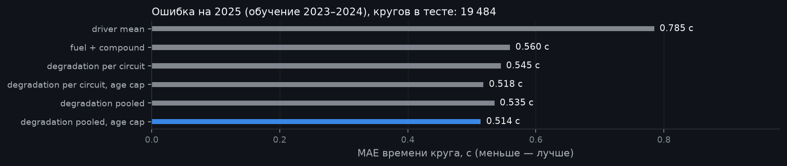
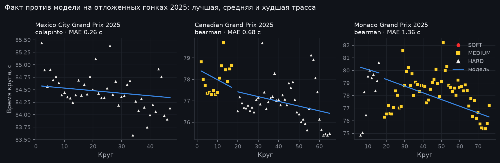
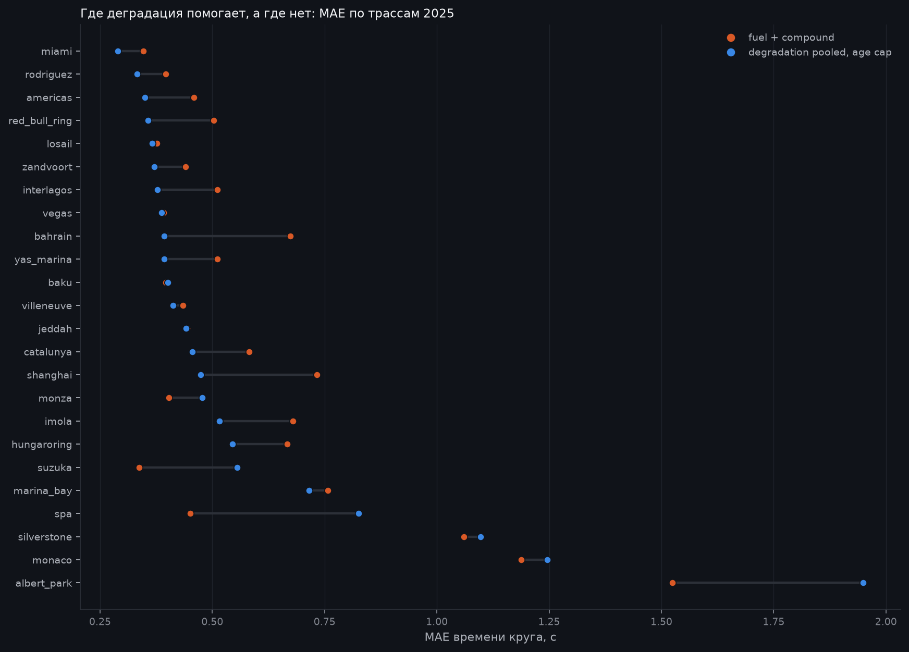

# Модель шин: метод и выводы

Модель оценивает, сколько времени машина теряет на круге из-за износа шин на каждом составе,
отдельно от выгорания топлива и от разницы между пилотами. Это вход для симулятора (Этап 4).

Отчёт полностью воспроизводится из базы:

```bash
python -m f1lab.models   # пишет графики, degradation_params.csv и results.md в docs/models
```

Все таблицы с числами лежат в [results.md](results.md), параметры по трассам в
[degradation_params.csv](degradation_params.csv).

## Данные и фильтр кругов

Берутся круги сезонов 2023–2025 из OpenF1. К каждому кругу присоединяется стинт, который его покрывает:
отсюда состав и возраст шины (возраст на старте стинта плюс пройденные круги). Если круг пит-стопа
указан в двух стинтах, он относится к старому: его проехали на старых шинах.

Модель видит только «чистые» круги. Каждому кругу записывается первая сработавшая причина исключения,
поэтому видно, сколько данных убрало каждое правило:

| Правило | Почему |
|---|---|
| нет времени круга | нечего моделировать |
| круг 1 | старт с места, не гоночный темп |
| in-lap и out-lap | время в пит-лейне |
| неизвестна шина | круг не покрыт стинтом |
| INTERMEDIATE, WET, UNKNOWN | дождевая резина ведёт себя иначе; модель только для сухой |
| SC, VSC, красный флаг | темп ограничен регламентом |
| круг после нейтрализации | рестарт, холодные шины |
| дождь в начале или в конце круга | мокрая трасса на сликах |
| медленнее медианы пилота в гонке больше чем на 5% | трафик, ошибки, повреждения |
| у пилота меньше 5 чистых кругов в гонке | уровень пилота не оценить |

Периоды SC, VSC и красного флага восстанавливаются по сообщениям дирекции гонки, потому что флага на
каждом круге в OpenF1 нет. Правило проверено на всех 70 гонках: найдено ровно 46 SC, 32 VSC и 11
красных флагов, как в сообщениях. Круг считается нейтрализованным, если его интервал времени
пересекает период.

Из 77 373 кругов чистыми остаются 61 492 (79,5%). Полностью выпадает только мокрый Сан-Паулу-2024.

## Модель

Для каждой трассы отдельная линейная регрессия (OLS) по всем её чистым кругам:

```
время круга = уровень[гонка, пилот]
            + топливо × номер круга
            + сдвиг[состав]
            + деградация[состав] × возраст шины
            + шум
```

- **Уровень** — фиксированный эффект пилота в конкретной гонке: машина, пилот, условия дня.
- **Топливо** — изменение темпа за круг гонки. Сюда же неизбежно попадает улучшение трассы
  (резина на асфальте): по временам кругов эти эффекты не разделить.
- **Сдвиг** — темп состава относительно эталонного (MEDIUM, если он есть на трассе).
- **Деградация** — секунды на круг возраста шины, отдельно для каждого состава, с 95% интервалом.

Топливо и деградацию можно отделить друг от друга, потому что возраст шины сбрасывается на пит-стопе,
а номер круга растёт монотонно. Если в данных трассы этого нет (все проехали один стинт, как в
Спа-2025), модель не подгоняется и сообщает, что параметры неидентифицируемы.

Поверх базовой регрессии два уточнения. Оба проверены на отложенных данных (см. абляцию ниже):

1. **Сжатие (partial pooling).** Наклон деградации трассы стягивается к общему наклону состава по
   всем трассам: эмпирический Байес, метаанализ случайных эффектов DerSimonian–Laird. Сила сжатия
   `k = τ² / (τ² + s²)` зависит от стандартной ошибки `s` оценки трассы: шумные оценки (например,
   Шанхай-2024 по 89 кругам) сильно движутся к среднему, точные почти не меняются. Затем трасса
   перестраивается с зафиксированными наклонами, чтобы топливо и сдвиги были согласованы с ними.
2. **Ограничение экстраполяции.** При прогнозе износ не растёт дальше максимального возраста шины,
   который встречался на этой трассе в обучающих данных. Линейный наклон, оценённый на стинтах до 20
   кругов, не продлевается на стинты в 45 кругов.

Корректность проверяется на синтетических гонках с заранее заданными параметрами: модель
восстанавливает топливо и деградацию с точностью ±0,005 с/круг.

## Оценка

Протокол честный по времени: параметры обучены на 2023–2024, а проверка идёт на 2025 году.
Уровень пилота в тестовой гонке берётся из самой гонки: симулятор его тоже будет знать (по
квалификации и темпу). Поэтому MAE показывает, насколько хорошо модель объясняет изменение темпа
внутри гонки, а это и есть её задача.

Все варианты сравниваются на одних и тех же 19 484 кругах (покрытие 92%; остальные приходятся на
составы, которых не было на трассе в обучении):



| Вариант | MAE, с |
|---|---|
| средний круг пилота | 0,785 |
| топливо + состав (без деградации) | 0,560 |
| деградация по трассе | 0,545 |
| + сжатие | 0,535 |
| + ограничение возраста | 0,518 |
| **сжатие + ограничение возраста (итоговая)** | **0,514** |

Итоговая модель на 35% точнее базовой. Деградация теперь даёт 0,046 с сверх варианта без неё (у
исходной регрессии было 0,015 с). Главный вклад дало ограничение экстраполяции. Сжатие помогает меньше,
потому что трассы действительно различаются (τ около 0,03 с/круг), и сильно стягиваются только оценки
по малым выборкам. Выигрыш есть на всех составах: SOFT 0,674 → 0,548, MEDIUM 0,533 → 0,506,
HARD 0,566 → 0,516.



На графике лучшая, средняя и худшая по ошибке трасса 2025 года. Выбираются только гонки, где у пилота
не меньше 30 предсказанных кругов, чтобы график не строился на обрывках данных.

## Где модель ошибается и почему



Итоговая модель лучше варианта без деградации на 17 трассах из 24 (исходная регрессия: на 15).
Уточнения исправили Шанхай (0,95 → 0,47 с, теперь лучше варианта без деградации) и смягчили Спа
(0,98 → 0,83). Оставшиеся провалы:

1. **Условия на трассе изменились между сезонами.** В Сузуке деградация в 2023–2024 была около
   0,12 с/круг, в 2025 около 0,03–0,06 с/круг. Это точная оценка, которая перестала быть верной.
   Сжатие её не трогает, и так и должно быть.
2. **Мокрые гонки и управление темпом.** Альберт-Парк и Сильверстоун 2025 шли в дождь, чистых кругов
   мало. В Монако-2025 из-за обязательных двух пит-стопов команды намеренно сдерживали темп.
3. **Сдвиги составов неустойчивы.** Они смешаны с отбором: составы ставят в разные моменты гонки
   разным машинам, а номинации C1–C5 меняются год от года. Наклоны деградации при этом устойчивы.


Деградация по трассам (все три сезона, итоговая модель) согласуется с репутацией трасс. Среди самых
тяжёлых для шин Бахрейн, Абу-Даби и Шанхай, среди самых лёгких Монако, Майами, Баку и Джидда.
Отрицательных наклонов нет. Медиана топлива −0,055 с/круг.

## Допущения

- Деградация линейна по возрасту шины до максимального наблюдавшегося возраста, дальше постоянна.
- Наклоны трасс считаются выборкой из общего распределения для состава (основа сжатия).
- Топливо линейно по номеру круга и одинаково для всех составов; в нём сидит и улучшение трассы.
- Параметры трассы общие для всех сезонов в обучении, без учёта номинации C1–C5 и изменений машин.
- Уровень пилота постоянен в течение гонки (нет борьбы, управления темпом, повреждений).
- Сухие составы только; дождевые круги не моделируются.

## Известные проблемы данных

- В OpenF1 для Майами-2025 есть только 559 из ~1100 кругов (у большинства пилотов нет кругов 2–24).
  Это ловит проверка качества `incomplete_lap_coverage`. Модель использует имеющиеся круги.
- Флага SC на каждом круге нет, периоды восстанавливаются по сообщениям (см. выше).

## Что можно улучшить дальше

- **Вес свежих сезонов**, чтобы быстрее реагировать на дрейф вроде Сузуки.
- **Номинация C1–C5** вместо названий SOFT/MEDIUM/HARD.
- **Нелинейная деградация** (квадратичный член или «обрыв») для длинных стинтов.
