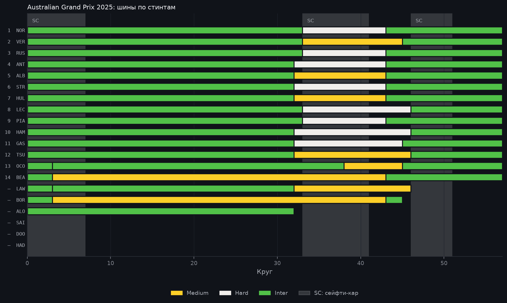

# Australian Grand Prix 2025: разбор гонки

> Автоматический отчёт, собранный по шаблону из данных OpenF1 и Jolpica-F1
> (`python -m f1lab.report --season 2025 --round 1`). Факты взяты из протоколов
> как есть. Всё, что сказано от имени симулятора, — оценка модели, а не факт.

16 марта 2025 · Albert Park Grand Prix Circuit, Australia · 57 кругов · воздух 16 °C, трасса 19 °C · мокрая гонка.

## Итог

Победил **Lando Norris** (McLaren), стартовав с 1-го места. Отрыв от второго места — 0,9 с.

Подиум:

1. Lando Norris, McLaren (старт P1)
2. Max Verstappen, Red Bull (старт P3)
3. George Russell, Mercedes (старт P4)

С поула стартовал Lando Norris и финишировал P1.
Быстрый круг — Lando Norris: 1:22,167 на 43-м круге.
Классифицированы 14 из 20 стартовавших.

## Позиции

Больше всех отыграли:

- Andrea Kimi Antonelli: с 16-го места на P4 (+12)
- Nico Hülkenberg: с 17-го места на P7 (+10)
- Lance Stroll: с 13-го места на P6 (+7)

Больше всех потеряли:

- Oscar Piastri: с 2-го места на P9 (−7)
- Yuki Tsunoda: с 5-го места на P12 (−7)
- Lewis Hamilton: с 8-го места на P10 (−2)

Не доехали до финиша:

- Liam Lawson (Red Bull): сход, 46 кругов
- Gabriel Bortoleto (Sauber): сход, 45 кругов
- Fernando Alonso (Aston Martin): сход, 32 круга
- Carlos Sainz (Williams): сход, 0 кругов
- Jack Doohan (Alpine F1 Team): сход, 0 кругов
- Isack Hadjar (RB F1 Team): сход, 0 кругов

## Пит-стопы и шины

- 2 пит-стопа: 12 финишёров
- 3 пит-стопа: 2 финишёра

| Финиш | Пилот | Старт | Пит-стопы | Шины |
|---:|---|---:|---:|---|
| 1 | Lando Norris | 1 | 2 | Inter → Hard → Inter |
| 2 | Max Verstappen | 3 | 2 | Inter → Medium → Inter |
| 3 | George Russell | 4 | 2 | Inter → Hard → Inter |
| 4 | Andrea Kimi Antonelli | 16 | 2 | Inter → Hard → Inter |
| 5 | Alexander Albon | 6 | 2 | Inter → Medium → Inter |
| 6 | Lance Stroll | 13 | 2 | Inter → Hard → Inter |
| 7 | Nico Hülkenberg | 17 | 2 | Inter → Medium → Inter |
| 8 | Charles Leclerc | 7 | 2 | Inter → Hard → Inter |
| 9 | Oscar Piastri | 2 | 2 | Inter → Hard → Inter |
| 10 | Lewis Hamilton | 8 | 2 | Inter → Hard → Inter |
| 11 | Pierre Gasly | 9 | 2 | Inter → Hard → Inter |
| 12 | Yuki Tsunoda | 5 | 2 | Inter → Medium → Inter |
| 13 | Esteban Ocon | 19 | 3 | Inter → Inter → Medium → Inter |
| 14 | Oliver Bearman | 20 | 3 | Inter → Medium → Inter |
| сход | Liam Lawson | 18 | 2 | Inter → Inter → Medium |
| сход | Gabriel Bortoleto | 15 | 3 | Inter → Medium → Inter |
| сход | Fernando Alonso | 12 | 0 | Inter |
| сход | Carlos Sainz | 10 | 0 | — |
| сход | Jack Doohan | 14 | 0 | — |
| сход | Isack Hadjar | 11 | 0 | — |

Сейфти-кар проводил поле через пит-лейн: в протоколе это 47 «пит-стопов» на кругах 2–4 без смены шин. Здесь они пит-стопами не считаются.

## Нейтрализации

- Сейфти-кар: круги 1–7, 15,7 мин
- Сейфти-кар: круги 34–41, 17,3 мин
- Сейфти-кар: круги 47–51, 10,2 мин

## Взгляд симулятора

Симулятор эту гонку не считал: мокрая гонка, а симулятор считает только сухие.

## Графики

---

Как это посчитано: [допущения симулятора](https://github.com/tachiroz/f1-strategy-lab/blob/main/docs/assumptions.md),
[модель шин](https://github.com/tachiroz/f1-strategy-lab/blob/main/docs/models/tyre_model.md).
