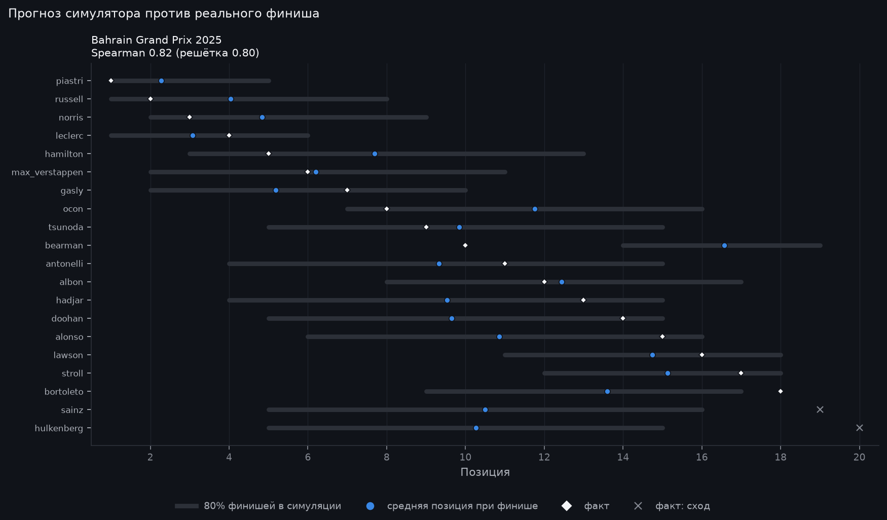
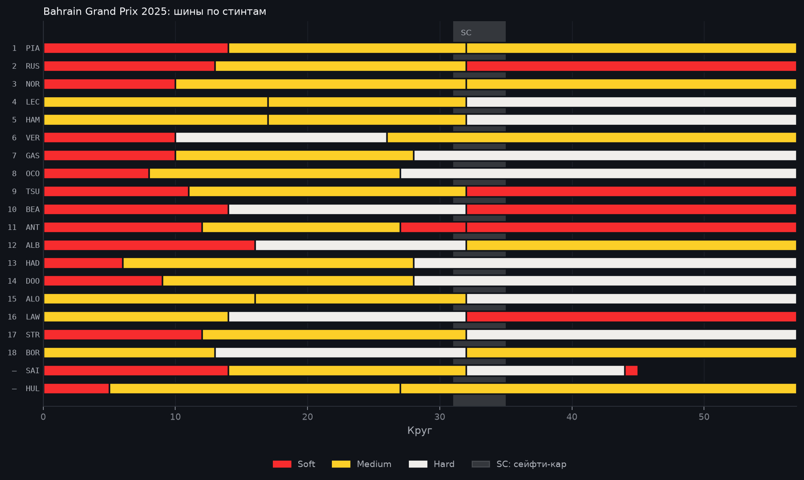

# Bahrain Grand Prix 2025: разбор гонки

> Автоматический отчёт, собранный по шаблону из данных OpenF1 и Jolpica-F1
> (`python -m f1lab.report --season 2025 --round 4`). Факты взяты из протоколов
> как есть. Всё, что сказано от имени симулятора, — оценка модели, а не факт.

13 апреля 2025 · Bahrain International Circuit, Bahrain · 57 кругов · воздух 27 °C, трасса 32 °C.

## Итог

Победил **Oscar Piastri** (McLaren), стартовав с 1-го места. Отрыв от второго места — 15,5 с.

Подиум:

1. Oscar Piastri, McLaren (старт P1)
2. George Russell, Mercedes (старт P3)
3. Lando Norris, McLaren (старт P6)

С поула стартовал Oscar Piastri и финишировал P1.
Быстрый круг — Oscar Piastri: 1:35,140 на 36-м круге.
Классифицированы 18 из 20 стартовавших.

## Позиции

Больше всех отыграли:

- Oliver Bearman: с 20-го места на P10 (+10)
- Esteban Ocon: с 14-го места на P8 (+6)
- Lewis Hamilton: с 9-го места на P5 (+4)

Больше всех потеряли:

- Andrea Kimi Antonelli: с 5-го места на P11 (−6)
- Pierre Gasly: с 4-го места на P7 (−3)
- Jack Doohan: с 11-го места на P14 (−3)

Не доехали до финиша:

- Carlos Sainz (Williams): сход, 45 кругов

Дисквалификация: Nico Hülkenberg.

## Пит-стопы и шины

- 2 пит-стопа: 17 финишёров
- 3 пит-стопа: 1 финишёр

| Финиш | Пилот | Старт | Пит-стопы | Шины |
|---:|---|---:|---:|---|
| 1 | Oscar Piastri | 1 | 2 | Soft → Medium → Medium |
| 2 | George Russell | 3 | 2 | Soft → Medium → Soft |
| 3 | Lando Norris | 6 | 2 | Soft → Medium → Medium |
| 4 | Charles Leclerc | 2 | 2 | Medium → Medium → Hard |
| 5 | Lewis Hamilton | 9 | 2 | Medium → Medium → Hard |
| 6 | Max Verstappen | 7 | 2 | Soft → Hard → Medium |
| 7 | Pierre Gasly | 4 | 2 | Soft → Medium → Hard |
| 8 | Esteban Ocon | 14 | 2 | Soft → Medium → Hard |
| 9 | Yuki Tsunoda | 10 | 2 | Soft → Medium → Soft |
| 10 | Oliver Bearman | 20 | 2 | Soft → Hard → Soft |
| 11 | Andrea Kimi Antonelli | 5 | 3 | Soft → Medium → Soft → Soft |
| 12 | Alexander Albon | 15 | 2 | Soft → Hard → Medium |
| 13 | Isack Hadjar | 12 | 2 | Soft → Medium → Hard |
| 14 | Jack Doohan | 11 | 2 | Soft → Medium → Hard |
| 15 | Fernando Alonso | 13 | 2 | Medium → Medium → Hard |
| 16 | Liam Lawson | 17 | 2 | Medium → Hard → Soft |
| 17 | Lance Stroll | 19 | 2 | Soft → Medium → Hard |
| 18 | Gabriel Bortoleto | 18 | 2 | Medium → Hard → Medium |
| сход | Carlos Sainz | 8 | 3 | Soft → Medium → Hard → Soft |
| дискв. | Nico Hülkenberg | 16 | 2 | Soft → Medium → Medium |

## Нейтрализации

- Сейфти-кар: круги 32–35, 7,8 мин

## Взгляд симулятора

> Оценка модели, а не факт. Симулятор знал квалификацию, решётку и стратегии, которые пилоты
> реально выбрали, и прогнал гонку 5000 раз. Калибровка эту гонку не видела: это прогноз вне выборки.

- **Фаворит до старта:** Oscar Piastri, победа в 42% прогонов. Он и выиграл.
- **Точность:** средняя ошибка позиции 2,42 у симулятора против 2,72 у модели «финиш = решётка» (18 финишёров). Совпадение порядка (Spearman): 0,82 против 0,80.
- **Safety Car:** выезжал в 32% прогонов; в реальности выезжал.
- **Выше ожиданий:** Oliver Bearman — P10, а в 80% прогонов модель видела его на P14–P19 (в среднем 16,6).
- **Ниже ожиданий:** Gabriel Bortoleto — P18 при ожидаемых P9–P17 (в среднем 13,6).
- **Стратегии призёров:** для каждого из первых 3 симулятор перебрал самые частые стратегии поля (2000 прогонов на вариант). Вариант попадает сюда, если в среднем он лучше хотя бы на 0,1 позиции и весь 95% интервал разницы ниже нуля.
  - Oscar Piastri: `M-17-M-32-H` вместо `S3-14-M-32-M` — в среднем на 0,16 позиции выше (95% интервал разницы −0,23…−0,09).
  - George Russell: `S3-14-M-32-M` вместо `S3-13-M-32-S` — в среднем на 0,79 позиции выше (95% интервал разницы −0,87…−0,71).

## Графики

---

Как это посчитано: [допущения симулятора](https://github.com/tachiroz/f1-strategy-lab/blob/main/docs/assumptions.md),
[модель шин](https://github.com/tachiroz/f1-strategy-lab/blob/main/docs/models/tyre_model.md).
