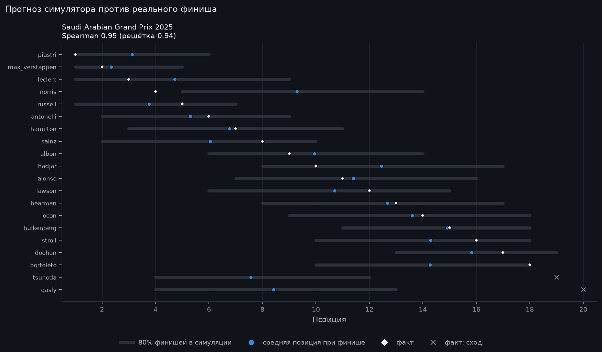
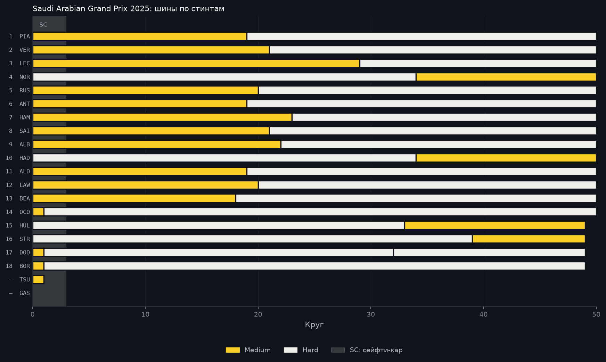

# Saudi Arabian Grand Prix 2025: разбор гонки

> Автоматический отчёт, собранный по шаблону из данных OpenF1 и Jolpica-F1
> (`python -m f1lab.report --season 2025 --round 5`). Факты взяты из протоколов
> как есть. Всё, что сказано от имени симулятора, — оценка модели, а не факт.

20 апреля 2025 · Jeddah Corniche Circuit, Saudi Arabia · 50 кругов · воздух 29 °C, трасса 38 °C.

## Итог

Победил **Oscar Piastri** (McLaren), стартовав с 2-го места. Отрыв от второго места — 2,8 с.

Подиум:

1. Oscar Piastri, McLaren (старт P2)
2. Max Verstappen, Red Bull (старт P1)
3. Charles Leclerc, Ferrari (старт P4)

С поула стартовал Max Verstappen и финишировал P2.
Быстрый круг — Lando Norris: 1:31,778 на 41-м круге.
Классифицированы 18 из 20 стартовавших.

## Позиции

Больше всех отыграли:

- Lando Norris: с 10-го места на P4 (+6)
- Esteban Ocon: с 19-го места на P14 (+5)
- Isack Hadjar: с 14-го места на P10 (+4)

Больше всех потеряли:

- George Russell: с 3-го места на P5 (−2)
- Carlos Sainz: с 6-го места на P8 (−2)
- Max Verstappen: с 1-го места на P2 (−1)

Не доехали до финиша:

- Yuki Tsunoda (Red Bull): сход, 1 круг
- Pierre Gasly (Alpine F1 Team): сход, 0 кругов

## Пит-стопы и шины

- 1 пит-стоп: 17 финишёров
- 2 пит-стопа: 1 финишёр

| Финиш | Пилот | Старт | Пит-стопы | Шины |
|---:|---|---:|---:|---|
| 1 | Oscar Piastri | 2 | 1 | Medium → Hard |
| 2 | Max Verstappen | 1 | 1 | Medium → Hard |
| 3 | Charles Leclerc | 4 | 1 | Medium → Hard |
| 4 | Lando Norris | 10 | 1 | Hard → Medium |
| 5 | George Russell | 3 | 1 | Medium → Hard |
| 6 | Andrea Kimi Antonelli | 5 | 1 | Medium → Hard |
| 7 | Lewis Hamilton | 7 | 1 | Medium → Hard |
| 8 | Carlos Sainz | 6 | 1 | Medium → Hard |
| 9 | Alexander Albon | 11 | 1 | Medium → Hard |
| 10 | Isack Hadjar | 14 | 1 | Hard → Medium |
| 11 | Fernando Alonso | 13 | 1 | Medium → Hard |
| 12 | Liam Lawson | 12 | 1 | Medium → Hard |
| 13 | Oliver Bearman | 15 | 1 | Medium → Hard |
| 14 | Esteban Ocon | 19 | 1 | Medium → Hard |
| 15 | Nico Hülkenberg | 18 | 1 | Hard → Medium |
| 16 | Lance Stroll | 16 | 1 | Hard → Medium |
| 17 | Jack Doohan | 17 | 2 | Medium → Hard → Hard |
| 18 | Gabriel Bortoleto | 20 | 1 | Medium → Hard |
| сход | Yuki Tsunoda | 8 | 0 | Medium |
| сход | Pierre Gasly | 9 | 0 | — |

## Нейтрализации

- Сейфти-кар: круги 1–3, 6,1 мин

## Взгляд симулятора

> Оценка модели, а не факт. Симулятор знал квалификацию, решётку и стратегии, которые пилоты
> реально выбрали, и прогнал гонку 5000 раз. Калибровка эту гонку не видела: это прогноз вне выборки.

- **Фаворит до старта:** Max Verstappen, победа в 42% прогонов. Победитель Oscar Piastri выигрывал в 22% прогонов (2-й по шансам).
- **Точность:** средняя ошибка позиции 1,45 у симулятора против 1,89 у модели «финиш = решётка» (18 финишёров). Совпадение порядка (Spearman): 0,95 против 0,94.
- **Safety Car:** выезжал в 56% прогонов; в реальности выезжал.
- **Выше ожиданий:** Lando Norris — P4, а в 80% прогонов модель видела его на P5–P14 (в среднем 9,3).
- **Стратегии призёров:** для каждого из первых 3 симулятор перебрал самые частые стратегии поля (2000 прогонов на вариант). Вариант попадает сюда, если в среднем он лучше хотя бы на 0,1 позиции и весь 95% интервал разницы ниже нуля.
  - Charles Leclerc: `M-20-H` вместо `M-29-H` — в среднем на 0,21 позиции выше (95% интервал разницы −0,31…−0,12).

## Графики

---

Как это посчитано: [допущения симулятора](https://github.com/tachiroz/f1-strategy-lab/blob/main/docs/assumptions.md),
[модель шин](https://github.com/tachiroz/f1-strategy-lab/blob/main/docs/models/tyre_model.md).
