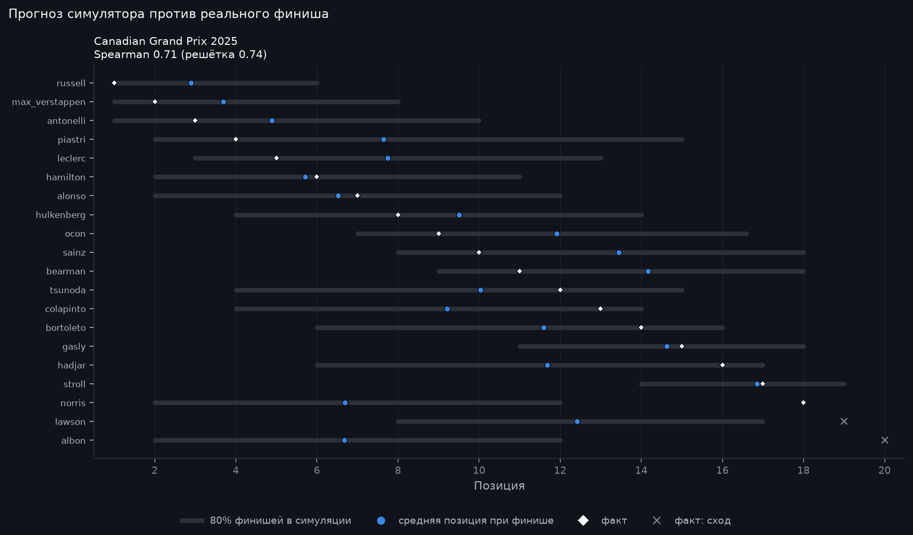
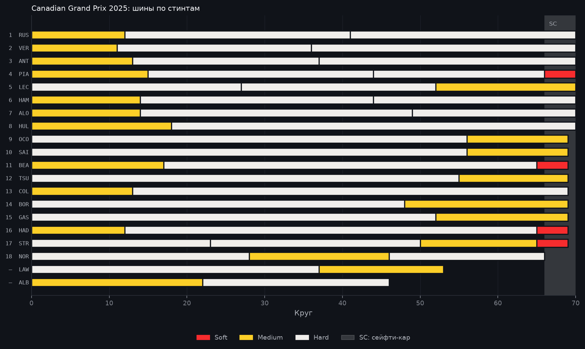

# Canadian Grand Prix 2025: разбор гонки

> Автоматический отчёт, собранный по шаблону из данных OpenF1 и Jolpica-F1
> (`python -m f1lab.report --season 2025 --round 10`). Факты взяты из протоколов
> как есть. Всё, что сказано от имени симулятора, — оценка модели, а не факт.

15 июня 2025 · Circuit Gilles Villeneuve, Canada · 70 кругов · воздух 24 °C, трасса 49 °C · был дождь.

## Итог

Победил **George Russell** (Mercedes), стартовав с 1-го места. Отрыв от второго места — 0,2 с.

Подиум:

1. George Russell, Mercedes (старт P1)
2. Max Verstappen, Red Bull (старт P2)
3. Andrea Kimi Antonelli, Mercedes (старт P4)

С поула стартовал George Russell и финишировал P1.
Быстрый круг — George Russell: 1:14,119 на 63-м круге.
Классифицированы 18 из 20 стартовавших.

## Позиции

Больше всех отыграли:

- Carlos Sainz: с 16-го места на P10 (+6)
- Yuki Tsunoda: с 18-го места на P12 (+6)
- Esteban Ocon: с 14-го места на P9 (+5)

Больше всех потеряли:

- Lando Norris: с 7-го места на P18 (−11)
- Isack Hadjar: с 12-го места на P16 (−4)
- Franco Colapinto: с 10-го места на P13 (−3)

Не доехали до финиша:

- Liam Lawson (RB F1 Team): сход, 53 круга
- Alexander Albon (Williams): сход, 46 кругов

## Пит-стопы и шины

- 1 пит-стоп: 7 финишёров
- 2 пит-стопа: 9 финишёров
- 3 пит-стопа: 2 финишёра

| Финиш | Пилот | Старт | Пит-стопы | Шины |
|---:|---|---:|---:|---|
| 1 | George Russell | 1 | 2 | Medium → Hard → Hard |
| 2 | Max Verstappen | 2 | 2 | Medium → Hard → Hard |
| 3 | Andrea Kimi Antonelli | 4 | 2 | Medium → Hard → Hard |
| 4 | Oscar Piastri | 3 | 3 | Medium → Hard → Hard → Soft |
| 5 | Charles Leclerc | 8 | 2 | Hard → Hard → Medium |
| 6 | Lewis Hamilton | 5 | 2 | Medium → Hard → Hard |
| 7 | Fernando Alonso | 6 | 2 | Medium → Hard → Hard |
| 8 | Nico Hülkenberg | 11 | 1 | Medium → Hard |
| 9 | Esteban Ocon | 14 | 1 | Hard → Medium |
| 10 | Carlos Sainz | 16 | 1 | Hard → Medium |
| 11 | Oliver Bearman | 13 | 2 | Medium → Hard → Soft |
| 12 | Yuki Tsunoda | 18 | 1 | Hard → Medium |
| 13 | Franco Colapinto | 10 | 1 | Medium → Hard |
| 14 | Gabriel Bortoleto | 15 | 1 | Hard → Medium |
| 15 | Pierre Gasly | 20 | 1 | Hard → Medium |
| 16 | Isack Hadjar | 12 | 2 | Medium → Hard → Soft |
| 17 | Lance Stroll | 17 | 3 | Hard → Hard → Medium → Soft |
| 18 | Lando Norris | 7 | 2 | Hard → Medium → Hard |
| сход | Liam Lawson | 19 | 1 | Hard → Medium |
| сход | Alexander Albon | 9 | 1 | Medium → Hard |

Сейфти-кар проводил поле через пит-лейн: в протоколе это 49 «пит-стопов» на кругах 66–69 без смены шин. Здесь они пит-стопами не считаются.

## Нейтрализации

- Сейфти-кар: круги 67–70, 7,4 мин

## Взгляд симулятора

> Оценка модели, а не факт. Симулятор знал квалификацию, решётку и стратегии, которые пилоты
> реально выбрали, и прогнал гонку 5000 раз. Калибровка эту гонку не видела: это прогноз вне выборки.

- **Фаворит до старта:** George Russell, победа в 33% прогонов. Он и выиграл.
- **Точность:** средняя ошибка позиции 2,66 у симулятора против 2,94 у модели «финиш = решётка» (18 финишёров). Совпадение порядка (Spearman): 0,71 против 0,74.
- **Safety Car:** выезжал в 70% прогонов; в реальности выезжал.
- **Ниже ожиданий:** Lando Norris — P18 при ожидаемых P2–P12 (в среднем 6,7).
- **Стратегии призёров:** для каждого из первых 3 симулятор перебрал самые частые стратегии поля (2000 прогонов на вариант). Вариант попадает сюда, если в среднем он лучше хотя бы на 0,1 позиции и весь 95% интервал разницы ниже нуля.
  - Max Verstappen: `M6-13-H-37-H` вместо `M3-11-H-36-H` — в среднем на 0,17 позиции выше (95% интервал разницы −0,23…−0,11).
  - Andrea Kimi Antonelli: `H-56-M` вместо `M6-13-H-37-H` — в среднем на 0,39 позиции выше (95% интервал разницы −0,51…−0,28).

## Графики

---

Как это посчитано: [допущения симулятора](https://github.com/tachiroz/f1-strategy-lab/blob/main/docs/assumptions.md),
[модель шин](https://github.com/tachiroz/f1-strategy-lab/blob/main/docs/models/tyre_model.md).
