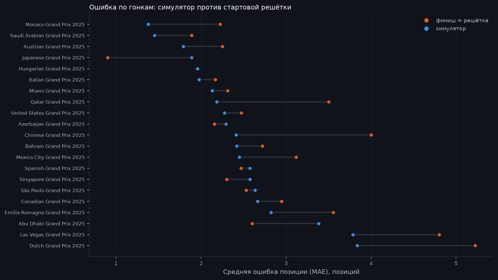

# Симулятор: бэктест

> Сгенерировано командой `python -m f1lab.sim backtest`, вручную не редактировать.
> Метод и допущения: [../assumptions.md](../assumptions.md).

Сезоны теста: 2025. Калибровка: 2023, 2024. Прогонов на гонку: 5000, seed 20261021. Обгон: преимущество от 1.5 с/круг, грязный воздух 1.0 с/круг.

Для каждой сухой гонки симулятор знает квалификацию, решётку и стратегии, которые пилоты реально выбрали. Сравнивается средняя позиция в симуляции с реальным финишем классифицированных пилотов; базовая модель - «финиш = позиция на решётке».

## Итог

| модель | Spearman | MAE, позиций |
|---|---|---|
| симулятор | 0.776 | 2.423 |
| финиш = решётка | 0.763 | 2.766 |

Гонок: 21; симулятор точнее решётки по MAE в 14.

## По гонкам

| race | spearman | grid_spearman | mae | grid_mae |
|---|---|---|---|---|
| Chinese Grand Prix 2025 | 0.753 | 0.688 | 2.413 | 4.000 |
| Japanese Grand Prix 2025 | 0.944 | 0.964 | 1.889 | 0.900 |
| Bahrain Grand Prix 2025 | 0.825 | 0.798 | 2.420 | 2.722 |
| Saudi Arabian Grand Prix 2025 | 0.948 | 0.944 | 1.453 | 1.889 |
| Miami Grand Prix 2025 | 0.853 | 0.879 | 2.131 | 2.312 |
| Emilia Romagna Grand Prix 2025 | 0.742 | 0.668 | 2.823 | 3.556 |
| Monaco Grand Prix 2025 | 0.930 | 0.872 | 1.377 | 2.222 |
| Spanish Grand Prix 2025 | 0.725 | 0.784 | 2.572 | 2.471 |
| Canadian Grand Prix 2025 | 0.707 | 0.736 | 2.664 | 2.944 |
| Austrian Grand Prix 2025 | 0.853 | 0.824 | 1.790 | 2.250 |
| Hungarian Grand Prix 2025 | 0.874 | 0.904 | 1.960 | 1.947 |
| Dutch Grand Prix 2025 | 0.259 | 0.199 | 3.837 | 5.222 |
| Italian Grand Prix 2025 | 0.913 | 0.841 | 1.976 | 2.167 |
| Azerbaijan Grand Prix 2025 | 0.867 | 0.877 | 2.291 | 2.158 |
| Singapore Grand Prix 2025 | 0.839 | 0.824 | 2.574 | 2.300 |
| United States Grand Prix 2025 | 0.856 | 0.840 | 2.275 | 2.474 |
| Mexico City Grand Prix 2025 | 0.801 | 0.828 | 2.449 | 3.118 |
| São Paulo Grand Prix 2025 | 0.674 | 0.684 | 2.634 | 2.529 |
| Las Vegas Grand Prix 2025 | 0.439 | 0.393 | 3.786 | 4.800 |
| Qatar Grand Prix 2025 | 0.734 | 0.707 | 2.183 | 3.500 |
| Abu Dhabi Grand Prix 2025 | 0.762 | 0.774 | 3.382 | 2.600 |

## Пропущенные гонки

| race_id | причина |
|---|---|
| 202501 | Australian Grand Prix: ['INTERMEDIATE'] tyres used; the simulator is dry-only |
| 202512 | British Grand Prix: ['INTERMEDIATE'] tyres used; the simulator is dry-only |
| 202513 | Belgian Grand Prix: ['INTERMEDIATE'] tyres used; the simulator is dry-only |
